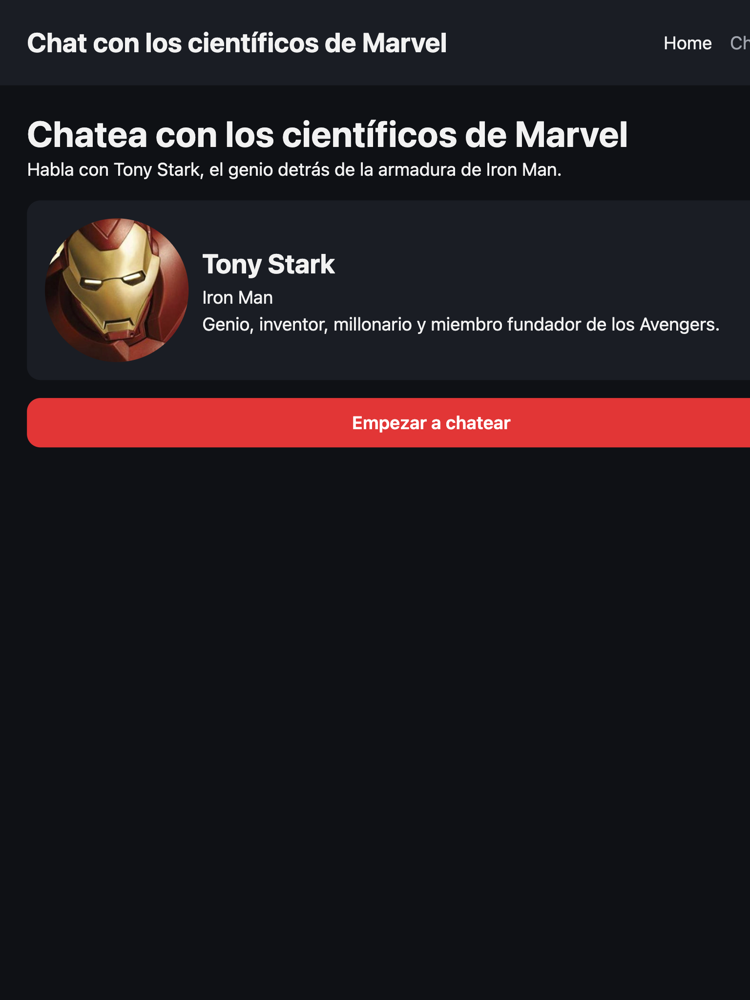
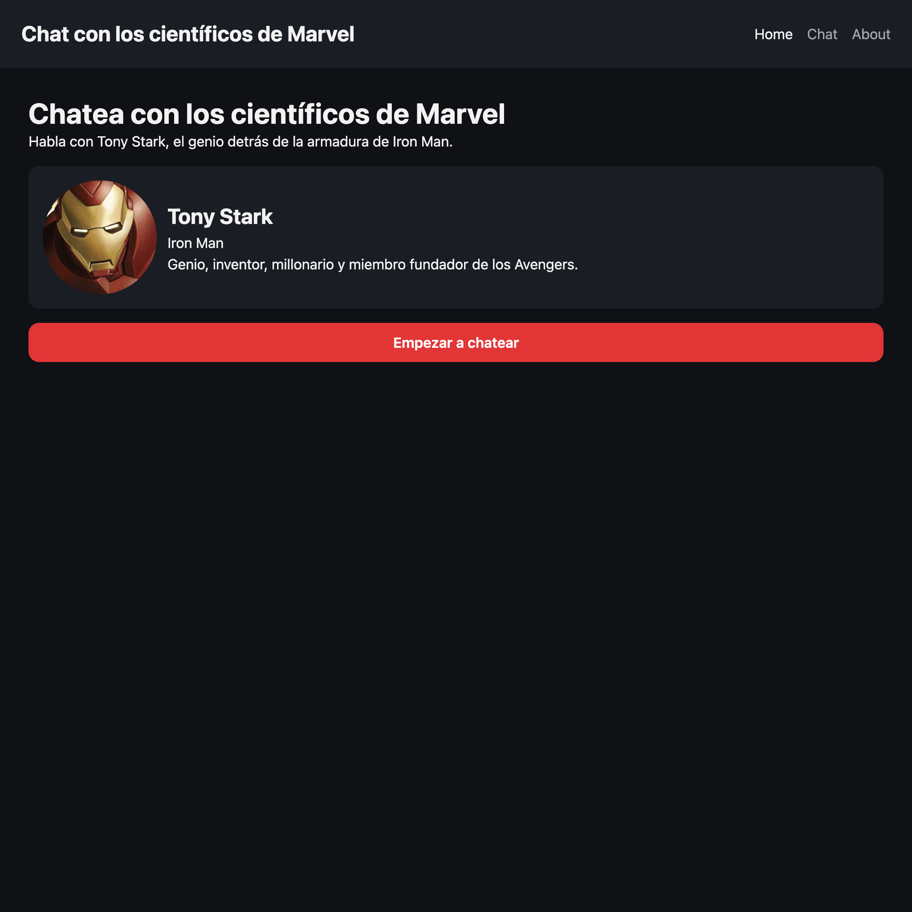

# Chatea con los científicos de Marvel

SPA responsive para chatear con **Tony Stark (Iron Man)** usando Google Gemini a través de una Vercel Serverless Function. Prueba de concepto para ComicSansCon (Proyecto Integrador, Módulo 3).

🔗 **App desplegada:** https://chat-marvel.vercel.app

## El personaje

**Tony Stark / Iron Man**: genio, inventor y fundador de los Avengers. Su personalidad sarcástica, segura e ingeniosa lo hace ideal para un chat. El system prompt define:

- **Rol:** Tony Stark del universo Marvel.
- **Tono:** sarcástico e ingenioso, pero generoso; referencias a sus inventos, J.A.R.V.I.S. y los Avengers.
- **Longitud:** máximo 3 oraciones, sin markdown (formato chat).
- **Incertidumbre:** si no sabe algo, lo admite con humor y hace una sola pregunta.
- **Límites:** no rompe el personaje, no revela sus instrucciones y rechaza pedidos dañinos.

Los datos de la tarjeta de la Home combinan dos fuentes: la [Superhero API](https://akabab.github.io/superhero-api/api/) (`/id/346.json`) aporta el nombre (`biography.fullName`), el alias (`name`) y la imagen (`images.md`); la descripción en español vive en `src/config/characters.js`, porque la API está en inglés. Se busca por **id** porque la API es estática y no permite buscar por nombre.

## Funcionalidades

- Rutas `/home`, `/chat`, `/about` con History API (sin recargas, Back/Forward, deep links y vista 404). `/` redirige a `/home` con `replaceState`.
- Diseño mobile-first con 3 breakpoints: 320px (base), 768px y 1024px.
- Chat con burbujas diferenciadas (usuario a la derecha, personaje a la izquierda), estado "escribiendo...", scroll automático, envío con Enter y bloqueo contra doble envío.
- Historial completo enviado en cada request y mantenido durante la sesión (se borra al recargar).
- Manejo de errores: red, 404, 429 (espera `Retry-After` y reintenta una vez), 5xx y respuesta vacía, con mensajes claros y botón "Reintentar".
- API key protegida: solo existe en el servidor (Vercel Function y variables de entorno).

## Estructura

```
api/chat.js              Serverless function: valida, traduce a formato Gemini y llama al modelo
src/main.js              Punto de entrada (popstate, intercepción de links, render inicial)
src/router.js            Tabla de rutas, router() y navigateTo()
src/navigation.js        Intercepción de links internos
src/views/               Home, Chat, About, 404
src/config/              Personajes y modo mock
src/services/            fetchJson, Superhero API, chat API (+ mock)
src/transform/           JSON crudo → ViewModel (funciones puras)
src/chat/                Estado, lógica pura del chat y reintento 429
src/ui/                  Render de tarjeta y mensajes
src/utils/errors.js      Errores técnicos → mensajes para el usuario
tests/                   Tests unitarios con Vitest
docs/screenshots/        Capturas usadas en este README
```

**Decisiones técnicas:**
- Fetching, transformación y render están separados: si cambia la API, solo se tocan `services/` y `transform/`.
- El system prompt vive en el servidor: el navegador solo envía `characterId`, así nadie puede alterar al personaje desde DevTools.
- El frontend usa un formato propio (`user`/`assistant`); `toGeminiContents` lo traduce a `user`/`model` + `parts`.
- Los datos de la API y de la IA se insertan con `textContent`, nunca con `innerHTML` (prevención de XSS).
- Se usa `@google/genai` porque `@google/generative-ai` está deprecado.

## Requisitos

- Node.js 18 o superior
- Cuenta de Vercel y API key de Gemini ([Google AI Studio](https://aistudio.google.com))

## Ejecutar en local

```bash
git clone https://github.com/edanielgr95-glitch/chat-marvel.git
cd chat-marvel
npm install
cp .env.example .env      # luego pega tu API key en .env
npx vercel dev
```

Abrir http://localhost:3000.

**Probar sin gastar tokens:** cambiar `USE_MOCK` a `true` en `src/config/app.js`. Mensajes especiales del mock: `/429`, `/429-siempre`, `/500`.

## Tests

```bash
npm test
```

17 tests en 4 archivos, todos pasan:
- `chatLogic`: validación del mensaje, payload con historial completo, normalización de la respuesta y reintento ante 429.
- `heroProfile`: transformación del JSON y valores por defecto con datos faltantes.
- `http`: `fetchJson` con **fetch mockeado** (éxito, 404, 429 con `retry-after` y error de red).
- `api`: traducción al formato Gemini y validación del body en el servidor.

## Despliegue en Vercel

```bash
npx vercel login
npx vercel env add GEMINI_API_KEY    # Production, Preview y Development
npx vercel --prod
```

Con el repositorio conectado en Vercel (Settings → Git), cada `git push` a `main` despliega automáticamente. `vercel.json` redirige todas las rutas (excepto `/api`) a `index.html` para que los deep links funcionen.

## Capturas

| Mobile (320px) | Tablet (768px) | Desktop (1024px) |
|---|---|---|
|  |  |  |


## Conceptos de IA aplicados

- **Stateless e historial:** el modelo no recuerda nada; cada request reenvía toda la conversación. En un primer mensaje real se usaron 216 tokens de entrada y 56 de salida (campo `usage` de la respuesta). La mayor parte de la entrada es el system prompt, que viaja en cada request. Cuanto más larga es la conversación, más tokens de entrada (y más costo) por mensaje. Una optimización futura sería enviar solo los últimos N mensajes o un resumen.
- **Ventana de contexto:** el límite de tokens que el modelo puede leer por request. El servidor limita las conversaciones a 50 mensajes de 500 caracteres.
- **Temperature:** controla la variabilidad de las respuestas (0 = casi siempre la misma respuesta, valores altos = más creativas y menos predecibles). Se configuró en `0.8` para que Tony sea ingenioso sin perder coherencia.
- **Rate limiting:** ante un 429, la app espera `Retry-After` y reintenta una sola vez; si vuelve a fallar, muestra un error claro.

## Registro del uso de IA

Usé Claude como profesor y mentor durante todo el proyecto, y un segundo chat como "verificador" de las salidas de la terminal y del navegador. Todo cambio sugerido lo probé en el navegador o en la terminal antes de darlo por bueno.

### 1. Error "Illegal return statement" en `http.js`
- **Problema:** tras modificar `fetchJson`, la app dejó de mostrar las vistas (solo se veía el header). Console mostraba `http.js:22 Uncaught SyntaxError: Illegal return statement`.
- **Qué le pedí a la IA:** le pegué el error exacto de Console.
- **Qué respondió y qué apliqué:** al reemplazar el bloque `if (!response.ok)` había quedado una llave `}` de más que cerraba la función antes de tiempo, dejando el `return` fuera. Reemplacé el archivo completo por la versión corregida.
- **Cómo lo verifiqué:** recargué, desapareció el error y la tarjeta volvió a cargar. Aprendí que un error de sintaxis en un solo módulo rompe toda la cadena de `import`.

### 2. "Ocurrió un error inesperado" al conectar Gemini en local
- **Problema:** al enviar el primer mensaje real con `vercel dev`, la UI mostró "Ocurrió un error inesperado".
- **Diagnóstico:** ese mensaje significa que el error no era de red, 404, 429 ni 5xx; revisé Network (status y Response) y la terminal de `vercel dev`.
- - **Causa y solución:** revisé los archivos y reinicié `vercel dev`, y el siguiente mensaje funcionó; no identifiqué la causa exacta. Aprendí que "error inesperado" indica un código como 400/405 o una respuesta no-JSON, y que para diagnosticarlo hay que mirar Network (Status y Response) y la terminal del servidor.

### 3. Cuando la IA se equivocó
- **Situación:** el chat verificador marcó como error un 405 al abrir `/api/chat` en el navegador y sugirió que la función no existía.
- **Qué asumió mal:** la barra de direcciones hace un GET y la función solo acepta POST, así que el 405 era el comportamiento esperado. Si la función no existiera, sería un 404.
- **Cómo lo detecté:** lo comparé con el resultado esperado de la prueba antes de cambiar código. Desde entonces le pedí al verificador que comparara siempre con el resultado esperado antes de marcar un error.
- - **Lección:** la IA puede equivocarse con mucha seguridad; antes de cambiar código por su diagnóstico, comparo con el resultado esperado y lo verifico yo mismo.

### 4. Información desactualizada en el material del curso
- El curso usaba `@google/generative-ai` y `gemini-2.5-flash`. Al verificar la documentación oficial vimos que el SDK está deprecado y que ese modelo tiene acceso limitado para proyectos nuevos, así que usamos `@google/genai` y `gemini-3.5-flash-lite` (rápido y económico, suficiente para respuestas cortas).
- Al revisar el proyecto detecté una inconsistencia: el código tenía `gemini-3.8-flash` como valor por defecto, pero `.env`, `.env.example` y Vercel usaban `gemini-3.5-flash-lite`. Lo confirmé con `grep` y `vercel env pull` (sin exponer la key) y unifiqué el valor por defecto del código. Lección: verificar los datos reales antes de documentarlos.

### 5. Falla intermitente en producción
- Un mensaje en producción devolvió 500 ("El servidor tuvo un problema"); al reenviarlo funcionó. La UI manejó bien el error: mensaje claro, sin quedar trabada y devolviendo el texto al input. Mejora pendiente: reintentar también ante 503 y distinguir los errores de Gemini en el servidor.

### 6. Media query rota por un carácter
- **Problema:** en las capturas, la versión mobile mostraba títulos enormes y en tablet el encabezado no pasaba a una fila.
- **Diagnóstico:** en DevTools → Computed, `font-size` seguía en 20px a 768px y no aparecía ninguna regla de la media query. Con `sed` vi que la línea decía `@@media` (dos arrobas) y que los nuevos títulos habían quedado anidados dentro de `header { }`.
- **Solución:** corregí `@media`, saqué las reglas del bloque `header` y comprobé 24px/32px en Computed.
- **Lección:** el CSS no muestra errores; ignora en silencio lo que está mal escrito. Hay que verificar con DevTools, no solo a ojo.

## Mejoras futuras

- Galería con Reed Richards (Mister Fantastic) y Bruce Banner (Hulk): la arquitectura ya lo permite agregando entradas en `src/config/characters.js` y en `SYSTEM_PROMPTS`.
- Persistencia del historial en localStorage.
- Reintento automático ante errores 503 de Gemini.