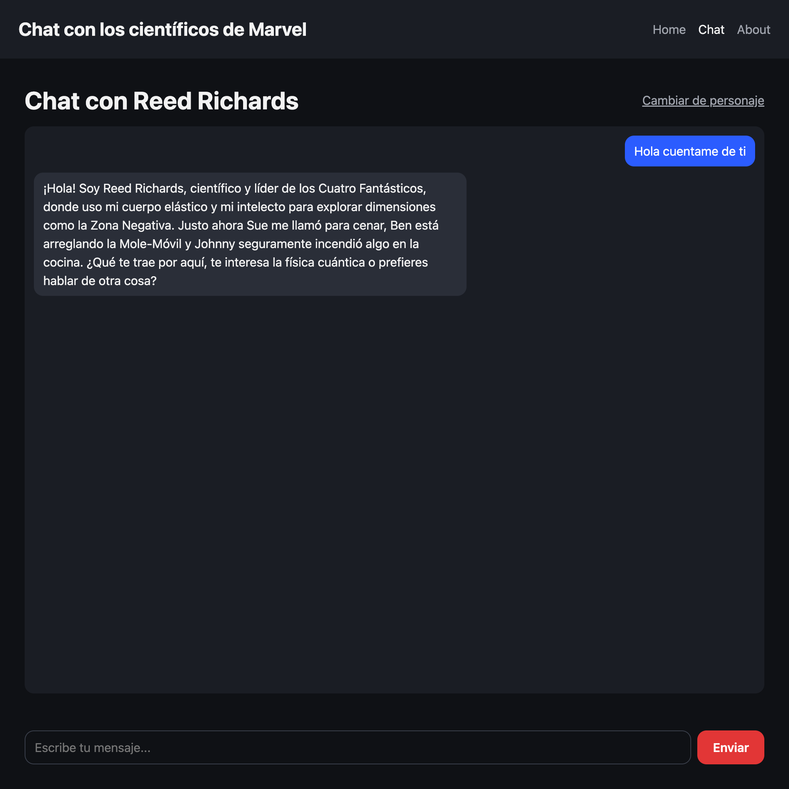

# Chatea con los científicos de Marvel

SPA responsive para chatear con tres genios de Marvel —**Tony Stark (Iron Man)**, **Reed Richards (Mister Fantastic)** y **Bruce Banner (Hulk)**— usando Google Gemini a través de una Vercel Serverless Function. Prueba de concepto para ComicSansCon (Proyecto Integrador, Módulo 3).

🔗 **App desplegada:** https://chat-marvel.vercel.app

## Los personajes

| Personaje | Universo | Tono en el chat |
|---|---|---|
| **Tony Stark** (Iron Man) | Avengers | Seguro, sarcástico e ingenioso; habla de sus inventos, J.A.R.V.I.S. y los Avengers. |
| **Reed Richards** (Mister Fantastic) | Cuatro Fantásticos | Entusiasta de la ciencia y analítico; menciona a su familia y la Zona Negativa. |
| **Bruce Banner** (Hulk) | Avengers | Tranquilo, reflexivo y con humor seco; habla de Hulk como "el otro tipo". |

Cada personaje tiene su **propio system prompt** (rol + tono) y todos comparten las mismas reglas (`SHARED_RULES`):

- **Longitud:** máximo 3 oraciones, en español y sin markdown (formato chat).
- **Incertidumbre:** si no sabe algo, lo admite con su propio estilo y hace una sola pregunta.
- **Límites:** no rompe el personaje, no revela sus instrucciones y rechaza pedidos dañinos.

Las tarjetas de la galería combinan dos fuentes: la [Superhero API](https://akabab.github.io/superhero-api/api/) (`/id/346.json`, `/id/456.json`, `/id/332.json`) aporta el nombre (`biography.fullName`), el alias (`name`) y la imagen (`images.md`); la descripción en español vive en `src/config/characters.js`, porque la API está en inglés. Se busca por **id** porque la API es estática y no permite buscar por nombre.

## Funcionalidades

- **Galería** (`/home`) con los tres personajes; cada tarjeta lleva a su chat (`/chat?personaje=reed`).
- Rutas `/home`, `/chat`, `/about` con History API (sin recargas, Back/Forward, deep links y vista 404). `/` redirige a `/home` con `replaceState`.
- Diseño mobile-first con 3 breakpoints: 320px (galería en 1 columna), 768px (2 columnas) y 1024px (3 columnas).
- Chat con burbujas diferenciadas (usuario a la derecha, personaje a la izquierda), estado "escribiendo...", scroll automático, envío con Enter y bloqueo contra doble envío.
- **Historial independiente por personaje**, enviado completo en cada request y mantenido durante la sesión (se borra al recargar).
- Manejo de errores: red, 404, 429 (espera `Retry-After` y reintenta una vez), 5xx y respuesta vacía, con mensajes claros; si falla, el texto vuelve al input para reintentar.
- Si la Superhero API falla, las tarjetas se muestran igual con los datos locales (sin foto) y el chat sigue disponible.
- API key protegida: solo existe en el servidor (Vercel Function y variables de entorno).

## Estructura

```
api/chat.js              Serverless function: valida, elige el system prompt, traduce a formato Gemini y llama al modelo
src/main.js              Punto de entrada (popstate, intercepción de links, render inicial)
src/router.js            Tabla de rutas, router() y navigateTo()
src/navigation.js        Intercepción de links internos
src/views/               Galería (Home), Chat, About, 404
src/config/              Personajes (CHARACTER_LIST, getCharacterById) y modo mock
src/services/            fetchJson, Superhero API, chat API (+ mock)
src/transform/           JSON crudo → ViewModel (funciones puras)
src/chat/                Estado por personaje, lógica pura del chat y reintento 429
src/ui/                  Render de tarjeta y mensajes
src/utils/errors.js      Errores técnicos → mensajes para el usuario
tests/                   Tests unitarios con Vitest
docs/screenshots/        Capturas usadas en este README
```

**Decisiones técnicas:**
- Fetching, transformación y render están separados: si cambia la API, solo se tocan `services/` y `transform/`.
- Los personajes son **datos**, no lógica: agregar uno nuevo es añadir una entrada en `src/config/characters.js` y su prompt en `SYSTEM_PROMPTS` (un test verifica que ambos coincidan).
- Los system prompts viven en el servidor: el navegador solo envía `characterId`, así nadie puede alterar a los personajes desde DevTools. Las reglas comunes se escriben una sola vez (`SHARED_RULES`).
- La galería pide los tres personajes en paralelo con `Promise.allSettled`: si uno falla, los demás se muestran igual.
- El personaje se lee de la URL con `URLSearchParams` y se valida con `getCharacterById`: un valor inventado (`?personaje=thanos`) abre el chat con Tony en lugar de romper la app.
- Cada formulario de chat lleva `data-character`: si llega la respuesta de un personaje mientras el usuario está en otro chat, se guarda en su historial pero no se dibuja en el chat equivocado.
- El frontend usa un formato propio (`user`/`assistant`); `toGeminiContents` lo traduce a `user`/`model` + `parts`.
- Los datos de la API y de la IA se insertan con `textContent`; `innerHTML` solo se usa con datos propios ya validados (prevención de XSS).
- Galería con CSS Grid; tarjetas, header y chat con Flexbox.
- Se usa `@google/genai` porque `@google/generative-ai` está deprecado.

## Requisitos

- Node.js 18 o superior
- Cuenta de Vercel y API key de Gemini ([Google AI Studio](https://aistudio.google.com))

## Ejecutar en local

```bash
git clone https://github.com/edanielgr95-glitch/chat-marvel.git
cd chat-marvel
npm install
cp .env.example .env      # luego pega tu API key en .env
npx vercel dev
```

Abrir http://localhost:3000. Usar `vercel dev` (no un servidor estático como `serve`), porque es el que ejecuta la función `/api/chat`.

**Probar sin gastar tokens:** cambiar `USE_MOCK` a `true` en `src/config/app.js`. Mensajes especiales del mock: `/429`, `/429-siempre`, `/500`.

## Tests

```bash
npm test
```

18 tests en 4 archivos, todos pasan:
- `chatLogic`: validación del mensaje, payload con historial completo, normalización de la respuesta y reintento ante 429.
- `heroProfile`: transformación del JSON y valores por defecto con datos faltantes.
- `http`: `fetchJson` con **fetch mockeado** (éxito, 404, 429 con `retry-after` y error de red).
- `api`: traducción al formato Gemini, validación del body y que el servidor acepte a todos los personajes de la galería.

## Despliegue en Vercel

```bash
npx vercel login
npx vercel env add GEMINI_API_KEY    # Production, Preview y Development
npx vercel --prod
```

Con el repositorio conectado en Vercel (Settings → Git), cada `git push` a `main` despliega a producción y cada push a otra rama crea una URL de preview. `vercel.json` redirige todas las rutas (excepto `/api`) a `index.html` para que los deep links funcionen.

## Capturas

| Mobile (320px) | Tablet (768px) | Desktop (1024px) |
|---|---|---|
|  |  |  |



## Conceptos de IA aplicados

- **Stateless e historial:** el modelo no recuerda nada; cada request reenvía toda la conversación de ese personaje. En un primer mensaje real se usaron 216 tokens de entrada y 56 de salida (campo `usage` de la respuesta). La mayor parte de la entrada es el system prompt, que viaja en cada request. Cuanto más larga es la conversación, más tokens de entrada (y más costo) por mensaje. Una optimización futura sería enviar solo los últimos N mensajes o un resumen.
- **Ventana de contexto:** el límite de tokens que el modelo puede leer por request. El servidor limita las conversaciones a 50 mensajes de 500 caracteres.
- **Temperature:** controla la variabilidad de las respuestas (0 = casi siempre la misma respuesta, valores altos = más creativas y menos predecibles). Se configuró en `0.8` para que los personajes sean expresivos sin perder coherencia.
- **Rate limiting:** ante un 429, la app espera `Retry-After` y reintenta una sola vez; si vuelve a fallar, muestra un error claro.

## Extra credit implementado

- **Selección de múltiples personajes:** galería con 3 personajes, tarjetas con foto y descripción, system prompt único por personaje e historial independiente.
- **Funcionalidades adicionales:** envío con Enter.

## Registro del uso de IA

Usé Claude como profesor y mentor durante todo el proyecto, y un segundo chat como "verificador" de las salidas de la terminal y del navegador. Todo cambio sugerido lo probé en el navegador o en la terminal antes de darlo por bueno.

### 1. Error "Illegal return statement" en `http.js`
- **Problema:** tras modificar `fetchJson`, la app dejó de mostrar las vistas (solo se veía el header). Console mostraba `http.js:22 Uncaught SyntaxError: Illegal return statement`.
- **Qué le pedí a la IA:** le pegué el error exacto de Console.
- **Qué respondió y qué apliqué:** al reemplazar el bloque `if (!response.ok)` había quedado una llave `}` de más que cerraba la función antes de tiempo, dejando el `return` fuera. Reemplacé el archivo completo por la versión corregida.
- **Cómo lo verifiqué:** recargué, desapareció el error y la tarjeta volvió a cargar. Aprendí que un error de sintaxis en un solo módulo rompe toda la cadena de `import`.

### 2. "Ocurrió un error inesperado" al conectar Gemini en local
- **Problema:** al enviar mensajes en local, la UI mostraba "Ocurrió un error inesperado".
- **Diagnóstico:** ese mensaje significa que el error no era de red, 404, 429 ni 5xx. Al repetirse durante la galería encontré la causa: estaba probando con `npx serve -s .`, que no ejecuta `/api/chat` y responde a cualquier ruta con `index.html`; `fetchJson` recibía un 200 con HTML y `response.json()` fallaba. Al cambiar a `npx vercel dev`, el chat funcionó.
- **Solución:** probar siempre con `npx vercel dev`. Es muy probable que el primer error, en la Etapa 6, tuviera la misma causa (en ese momento no lo identifiqué).

### 3. Cuando la IA se equivocó
- **Situación:** el chat verificador marcó como error un 405 al abrir `/api/chat` en el navegador y sugirió que la función no existía.
- **Qué asumió mal:** la barra de direcciones hace un GET y la función solo acepta POST, así que el 405 era el comportamiento esperado. Si la función no existiera, sería un 404.
- **Cómo lo detecté:** lo comparé con el resultado esperado de la prueba antes de cambiar código. Desde entonces le pedí al verificador que comparara siempre con el resultado esperado antes de marcar un error.
- **Lección:** la IA puede equivocarse con mucha seguridad; antes de cambiar código por su diagnóstico, comparo con el resultado esperado y lo verifico yo mismo.

### 4. Información desactualizada en el material del curso
- El curso usaba `@google/generative-ai` y `gemini-2.5-flash`. Al verificar la documentación oficial vimos que el SDK está deprecado y que ese modelo tiene acceso limitado para proyectos nuevos, así que usamos `@google/genai` y `gemini-3.5-flash-lite` (rápido y económico, suficiente para respuestas cortas).
- Al revisar el proyecto detecté una inconsistencia: el código tenía `gemini-3.8-flash` como valor por defecto, pero `.env`, `.env.example` y Vercel usaban `gemini-3.5-flash-lite`. Lo confirmé con `grep` y `vercel env pull` (sin exponer la key) y unifiqué el valor por defecto del código. Lección: verificar los datos reales antes de documentarlos.

### 5. Falla intermitente en producción
- Un mensaje en producción devolvió 500 ("El servidor tuvo un problema"); al reenviarlo funcionó. La UI manejó bien el error: mensaje claro, sin quedar trabada y devolviendo el texto al input. Mejora pendiente: reintentar también ante 503 y distinguir los errores de Gemini en el servidor.

### 6. Media query rota por un carácter
- **Problema:** en las capturas, la versión mobile mostraba títulos enormes y en tablet el encabezado no pasaba a una fila.
- **Diagnóstico:** en DevTools → Computed, `font-size` seguía en 20px a 768px y no aparecía ninguna regla de la media query. Con `sed` vi que la línea decía `@@media` (dos arrobas) y que los nuevos títulos habían quedado anidados dentro de `header { }`.
- **Solución:** corregí `@media`, saqué las reglas del bloque `header` y comprobé 24px/32px en Computed.
- **Lección:** el CSS no muestra errores; ignora en silencio lo que está mal escrito. Hay que verificar con DevTools, no solo a ojo.

### 7. Extra credit: lo que aprendí al agregar la galería
- **El mismo error de CSS, dos veces:** las reglas `.gallery` quedaron anidadas dentro de `header { }` y `#app { }`. En 768px la galería no pasaba a 2 columnas; en 1024px funcionaba solo por casualidad (`.gallery` sí está dentro de `#app`). Lo detectó una prueba automática que medía las columnas en cada breakpoint. Lección: pegar las reglas en la línea vacía entre bloques, no antes de un `}`.
- **Funciona en local ≠ está en Git:** al revisar `git status` antes del push, los cambios de los system prompts y de About no estaban en ningún commit. Sin esa revisión, la preview habría respondido "Personaje no válido" con Reed y Bruce.
- **Preview antes de producción:** trabajé en una rama `extras` y la probé en la URL de preview de Vercel antes de unirla a `main`, así la app entregada nunca estuvo rota.
- **Opciones que no hay que pulsar:** "Promote to Production" en Vercel (saltaría Git) y la conexión a Slack que Vercel ofrecía (no era necesaria).

## Mejoras futuras

- Persistencia del historial en localStorage.
- Reintento automático ante errores 503 de Gemini y mensajes de error del servidor más específicos.
- Revisar el aviso de accesibilidad que muestra la Vercel Toolbar en la preview.
